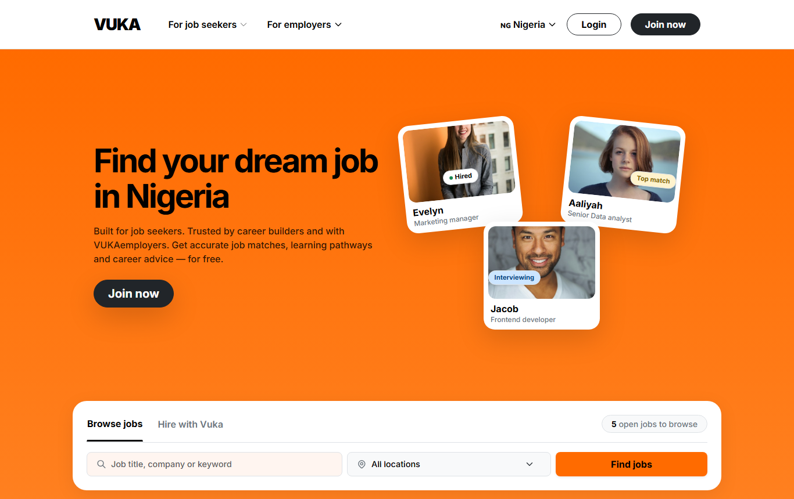
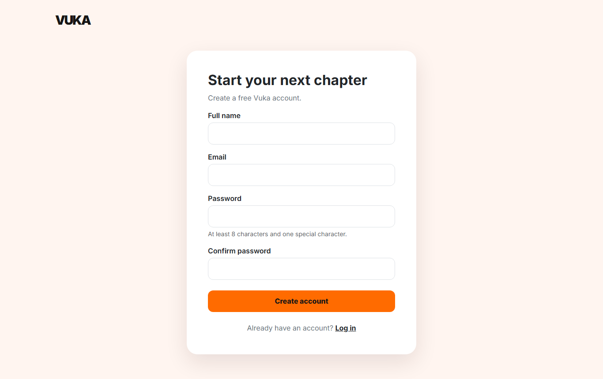
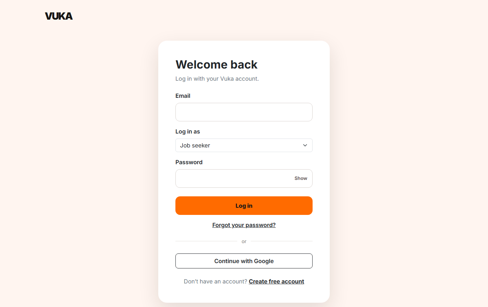

# VUKA: Job Board Built with PHP & MySQL

VUKA is a job-board website for job seekers in Nigeria. Employers sign up and post job openings. Job seekers create an account, browse and search those jobs, and save the ones they like to come back to later.

I built it from scratch in plain PHP, with no framework, to learn how a real web application works end to end: user accounts, logins, roles, a database, and pages that change based on who is signed in.

**View the code:** https://github.com/Akenne-dev/VukaPhp



---

## Features

**For everyone (no login needed)**
- Homepage that shows the 4 newest jobs and a live count of open jobs, both pulled from the database
- Search jobs by keyword (title, company, job type or description) and by location

**For job seekers**
- Sign up and log in
- Personal dashboard with a welcome message, number of open jobs, number of saved jobs, and the latest openings
- Jobs page with a list on the left and full job details on the right
- Instant filtering by job title, company or location without reloading the page
- Save or unsave a job with one click, and view all saved jobs in one place

**For employers / admins**
- Admin accounts can't be created from the public sign-up form. The site owner promotes them in the database, so strangers can't post jobs.
- A separate admin dashboard (job seekers can't open it)
- Form to post a new job: title, company, location, type (Full-time, Part-time, Contract, Remote, Internship) and description
- List of all jobs you have posted. Click one to see its full details in a pop-up

| Sign up | Log in |
|---|---|
|  |  |

---

## How I used PHP

| What | How it works in VUKA |
|---|---|
| **Connecting to the database** | `database.php` opens one MySQL connection with `mysqli` and is included at the top of every page with `require_once`. |
| **User accounts** | `signup.php` validates the form on the server: required fields, a valid email, a password of at least 8 characters with one special character, and matching passwords. It also checks that the email isn't already registered. |
| **Password security** | Passwords are never stored as plain text. They are hashed with `password_hash()` and checked at login with `password_verify()`. |
| **Sessions & login** | After a successful login, PHP `$_SESSION` stores the user's ID, name, email and role. `session_regenerate_id()` runs on login to protect against session hijacking. `logout.php` clears the session. |
| **Roles & access control** | Every user is either a `user` (job seeker) or an `admin` (employer). The sign-up page always creates job seekers, even if someone tampers with the form, so admin rights can only be granted in the database. Each protected page checks the session first and redirects anyone who shouldn't be there. For example, a job seeker trying to open `admin.php` is sent back to their dashboard. |
| **Keeping secrets off GitHub** | `database.php` uses the local XAMPP defaults. On a live server, it loads the real database password from `config.php`, a file listed in `.gitignore` so it is never pushed to GitHub. |
| **Preventing SQL injection** | Queries that use form data are built with **prepared statements** (`prepare()` + `bind_param()`), so user input is never pasted directly into SQL. |
| **Preventing XSS** | Everything shown on a page that came from a user, such as job titles, names and descriptions, goes through `htmlspecialchars()` first. |
| **A small JSON API** | `save-job.php` works as an API endpoint. When you click **Save** on the jobs page, JavaScript sends a `fetch()` request to it. PHP adds or removes the saved job in the database and returns a JSON reply, so the page updates without reloading. |
| **Dynamic pages** | PHP loops (`while`, `foreach`) turn database rows into job cards. `$_GET` parameters control what is shown, e.g. `jobs.php?saved=1` shows only saved jobs and `jobs.php?job=3` opens a specific job. |

---

## Tech stack

- **Backend:** PHP (plain PHP, no framework)
- **Database:** MySQL / MariaDB
- **Frontend:** HTML, CSS, [Bootstrap 5](https://getbootstrap.com/), plain JavaScript
- **Font:** Inter (Google Fonts)
- **Local server:** XAMPP (Apache + MySQL)

---

## Database

The database is called `vuka_db` and has three tables:

| Table | What it stores |
|---|---|
| `users` | Full name, email, hashed password, role (`user` or `admin`) |
| `jobs` | Title, company, location, job type, description, and which admin posted it |
| `saved_jobs` | Which job seeker saved which job. Each job can only be saved once per user. |

Foreign keys link the tables. Deleting a user also deletes their posted jobs and saved jobs.

---

## Project structure

```
VukaPhp/
├── index.php               Public homepage with job search and latest jobs
├── signup.php              Create an account (job seeker or employer)
├── login.php               Log in
├── logout.php              Log out and end the session
├── dashboard.php           Job seeker dashboard
├── jobs.php                Browse, filter and save jobs
├── save-job.php            JSON endpoint that saves/unsaves a job
├── admin.php               Employer dashboard: post jobs and view your postings
├── footer.php              Footer component
├── database.php            MySQL connection (local XAMPP defaults)
├── config.example.php      Template for live-server database settings (copy to config.php)
├── database.sql            Creates the database and all tables
├── schema-update.sql       Upgrade script for older copies of the database
├── saved-jobs-update.sql   Upgrade script that adds the saved_jobs table
└── screenshots/            Images used in this README
```

---

## Run it on your own computer

1. **Install [XAMPP](https://www.apachefriends.org/)** and start **Apache** and **MySQL** from the XAMPP Control Panel.
2. **Download the code** into XAMPP's `htdocs` folder:
   ```bash
   cd C:/xampp/htdocs
   git clone https://github.com/Akenne-dev/VukaPhp.git
   ```
   (Or click **Code → Download ZIP** on GitHub and unzip it into `htdocs/VukaPhp`.)
3. **Create the database:** open http://localhost/phpmyadmin, click the **SQL** tab, paste in the contents of `database.sql` and click **Go**.
4. **Check the connection settings** in `database.php`. They match a fresh XAMPP install (user `root`, no password). Change them if your MySQL login is different.
5. **Open the site:** http://localhost/VukaPhp/
6. **Create an admin (employer) account:** sign up on the site, then in phpMyAdmin's SQL tab run:
   ```sql
   UPDATE vuka_db.users SET role = 'admin' WHERE email = 'the-email-you-signed-up-with';
   ```
   Log in again choosing **Admin / employer** to post jobs. Then sign up with a different email as a job seeker to browse and save them.

---

## What I'd add next

- Working **Apply** button so job seekers can send applications
- Editing and deleting posted jobs
- Password reset by email
- "Continue with Google" sign-in (the button is there, but it isn't connected yet)
- An employer sign-up flow with admin approval (right now, admin accounts are set up in the database)
